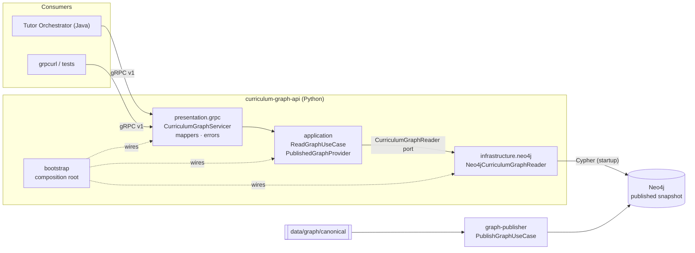
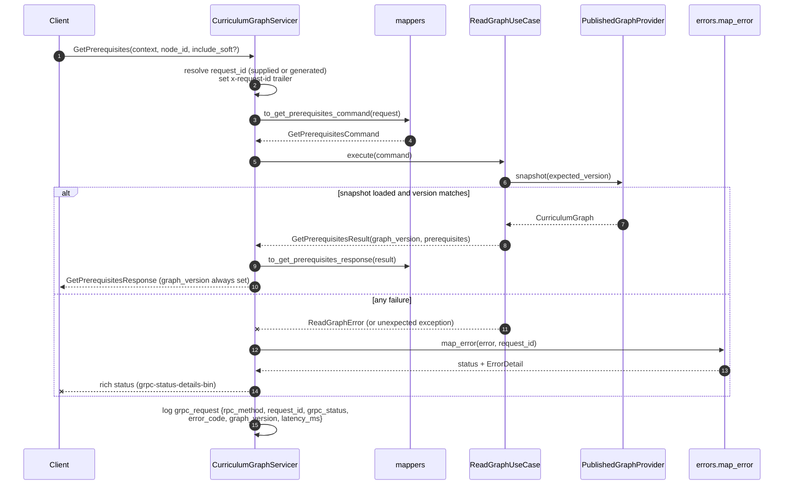

# Curriculum Graph gRPC API — Architecture and Integration

**Release:** v0.2.2
**Decision record:** [ADR-007](adr/ADR-007-read-only-grpc-api-foundation.md)
**Contract:** [Contract v1](grpc-api-contract.md) · [Generated reference](grpc-api-reference.md)
**Local runtime:** [Validation playbook](../../06-engineering/workflow/curriculum-graph-grpc-local-validation.md)

This document explains how the read-only gRPC API is built, how a request
flows through it, how errors are reported, and how the Tutor Orchestrator
consumes it.

---

## 1. Components



| Layer | Module | Responsibility |
|-------|--------|----------------|
| Contract | `proto/aigora/curriculum_graph/v1/` → `aigora.curriculum_graph.v1` | Versioned messages and service; generated code |
| Presentation | `aigora.curriculum_graph.presentation.grpc` | Request → command, result → response, error → rich status, request logging, health probe |
| Application | `aigora.curriculum_graph.application.use_cases.read_graph`, `services.published_graph_provider` | Query semantics, view models, version selector, read error taxonomy |
| Infrastructure | `aigora.curriculum_graph.infrastructure.neo4j` | Lossless versioned publication; snapshot reader |
| Composition | `aigora.curriculum_graph.bootstrap` | Wires adapters, background snapshot loading, logging, graceful shutdown |

Boundaries are enforced by import-linter (`pyproject.toml`): presentation never
imports domain or infrastructure directly; only presentation imports generated
contracts or gRPC.

---

## 2. Snapshot lifecycle

1. `graph-publisher` loads a canonical file (file-based, ADR-001) and publishes
   it through `PublishGraphUseCase`; every element is stamped with the graph
   version and `:GraphMetadata {key: 'active'}` records the active version.
2. At startup the API starts listening immediately and loads the active
   snapshot through `CurriculumGraphReader`. Until the load succeeds,
   `HealthCheck` answers `NOT_SERVING` and graph RPCs fail with
   `CG_GRAPH_UNAVAILABLE`; the loader retries every
   `GRAPH_LOAD_RETRY_SECONDS`.
3. Once loaded, every RPC is answered from memory. The snapshot is immutable:
   publishing a new version requires restarting the API.

`GRAPH_VERSION_DEFAULT` pins a deployment to one version: if the published
version differs, the API refuses to serve.

---

## 3. Request flow



---

## 4. Error model

| Application error | gRPC status | `ErrorDetail.code` | Retry? | `graph_version` in detail |
|-------------------|-------------|--------------------|--------|---------------------------|
| `GraphNodeNotFoundError` | `NOT_FOUND` | `CG_NODE_NOT_FOUND` | No | Yes |
| `GraphProfileNotFoundError` | `NOT_FOUND` | `CG_PROFILE_NOT_FOUND` | No | Yes |
| `GraphVersionMismatchError` | `FAILED_PRECONDITION` | `CG_INVALID_GRAPH_VERSION` | No | No (never echo an unbound version) |
| `GraphUnavailableError` | `UNAVAILABLE` | `CG_GRAPH_UNAVAILABLE` | Yes, with backoff | No |
| `InvalidReadRequestError` | `INVALID_ARGUMENT` | `CG_INVALID_REQUEST` | No | When the snapshot was resolved |
| anything else | `INTERNAL` | `""` | No | No; message is generic, details stay in server logs |

`ErrorDetail` always carries the `request_id`, which also appears in the
`x-request-id` trailer and the server's `grpc_request` log line, so one id
correlates client errors with server logs.

---

## 5. Consuming the API from the Tutor Orchestrator

### 5.1 Generate Java stubs

The `.proto` declares `java_package = "com.aigora.curriculumgraph.v1"`. In the
orchestrator's `pom.xml`, generate stubs from the shared contract:

```xml
<build>
  <extensions>
    <extension>
      <groupId>kr.motd.maven</groupId>
      <artifactId>os-maven-plugin</artifactId>
      <version>1.7.1</version>
    </extension>
  </extensions>
  <plugins>
    <plugin>
      <groupId>org.xolstice.maven.plugins</groupId>
      <artifactId>protobuf-maven-plugin</artifactId>
      <version>0.6.1</version>
      <configuration>
        <protoSourceRoot>${project.basedir}/../../proto</protoSourceRoot>
        <includes><include>aigora/curriculum_graph/v1/*.proto</include></includes>
        <protocArtifact>com.google.protobuf:protoc:3.25.5:exe:${os.detected.classifier}</protocArtifact>
        <pluginId>grpc-java</pluginId>
        <pluginArtifact>io.grpc:protoc-gen-grpc-java:1.68.1:exe:${os.detected.classifier}</pluginArtifact>
      </configuration>
      <executions>
        <execution><goals><goal>compile</goal><goal>compile-custom</goal></goals></execution>
      </executions>
    </plugin>
  </plugins>
</build>
```

Runtime dependencies: `io.grpc:grpc-netty-shaded`, `io.grpc:grpc-protobuf`,
`io.grpc:grpc-stub` and `com.google.api.grpc:proto-google-common-protos`
(for `StatusProto`). Generated types stay in the orchestrator's
infrastructure adapter (ADR-006 of the orchestrator).

### 5.2 Adapter sketch

```java
final class GrpcCurriculumGraphClient implements CurriculumGraphClient {
    private final CurriculumGraphServiceGrpc.CurriculumGraphServiceBlockingStub stub;

    @Override
    public List<NodeId> getPrerequisites(NodeId nodeId, GraphVersion graphVersion) {
        var request = GetPrerequisitesRequest.newBuilder()
            .setContext(RequestContext.newBuilder()
                .setRequestId(correlationId())               // propagate the orchestration correlation id
                .setGraphVersion(graphVersion.value()))      // pin the session's graph version
            .setNodeId(nodeId.value())
            .build();
        try {
            return stub.withDeadlineAfter(500, TimeUnit.MILLISECONDS)
                .getPrerequisites(request)
                .getPrerequisitesList().stream()
                .map(p -> new NodeId(p.getNode().getId()))
                .toList();
        } catch (StatusRuntimeException e) {
            throw translate(e);
        }
    }

    @Override
    public boolean nodeExists(NodeId nodeId, GraphVersion graphVersion) {
        try {
            stub.getNode(GetNodeRequest.newBuilder()
                .setContext(RequestContext.newBuilder().setGraphVersion(graphVersion.value()))
                .setNodeId(nodeId.value()).build());
            return true;
        } catch (StatusRuntimeException e) {
            if (canonicalCode(e).equals("CG_NODE_NOT_FOUND")) return false;
            throw translate(e);
        }
    }

    private static String canonicalCode(StatusRuntimeException e) {
        var status = StatusProto.fromThrowable(e);
        if (status == null) return "";
        for (var any : status.getDetailsList()) {
            if (any.is(ErrorDetail.class)) {
                try { return any.unpack(ErrorDetail.class).getCode(); }
                catch (InvalidProtocolBufferException ignored) { }
            }
        }
        return "";
    }

    private RuntimeException translate(StatusRuntimeException e) {
        return switch (canonicalCode(e)) {
            case "CG_GRAPH_UNAVAILABLE" -> new GraphUnavailable(e);          // retryable
            case "CG_INVALID_GRAPH_VERSION" -> new InvalidGraphResponse(e);   // version drift: re-resolve
            default -> e.getStatus().getCode() == Status.Code.DEADLINE_EXCEEDED
                ? new DependencyTimeout(e) : new InvalidGraphResponse(e);
        };
    }
}
```

### 5.3 Port-to-RPC mapping

The orchestrator's `CurriculumGraphClient` port predates the frozen v1
contract. How each method is served:

| Port method | v1 RPC(s) | Notes |
|-------------|-----------|-------|
| `getPrerequisites(nodeId, version)` | `GetPrerequisites` | Direct. Use `include_soft = false` for hard prerequisites only. |
| `nodeExists(nodeId, version)` | `GetNode` | `CG_NODE_NOT_FOUND` → `false`. |
| `getNextCandidateLearningNodes(current, student, version)` | `ListNodes` + `GetPrerequisites` | **Gap (#293):** v1 has no "dependents" RPC yet. Build the forward adjacency once per `graph_version` (list all nodes, ask each for its prerequisites) and cache it; the snapshot is immutable per version. Candidate filtering by student state stays in the orchestrator. |
| `getUnlockedNodes(student, version)` | same cached adjacency | Requires student mastery (Student Model); the graph only supplies topology. |
| `getCurrentLearningNode(student, version)` | — | Not a Curriculum Graph concern: the current node is student/session state. |

The gap above is closed by an **additive** v1 evolution, which the
compatibility rules allow without a `v2`: a `GetDependents` RPC, tracked in
[#293](https://github.com/AigoraCorporation/aigora/issues/293) (release v0.3.2,
blocks the orchestrator adapter #245). Until it ships, use the cached adjacency
described above.

### 5.4 Python client

```python
import grpc
from aigora.curriculum_graph.v1 import curriculum_graph_pb2 as pb, curriculum_graph_pb2_grpc as pb_grpc
from aigora.curriculum_graph.presentation.grpc.errors import error_detail_from

with grpc.insecure_channel("localhost:50051") as channel:
    stub = pb_grpc.CurriculumGraphServiceStub(channel)
    try:
        path = stub.GetLearningPath(
            pb.GetLearningPathRequest(start_node_id="math.arithmetic.fractions",
                                      target_node_id="math.algebra.linear-equations"),
            timeout=1.0,
        )
        print(path.graph_version, [n.id for n in path.path])
    except grpc.RpcError as error:
        detail = error_detail_from(error)
        print(error.code(), detail.code if detail else "", detail.request_id if detail else "")
```

### 5.5 Consumer guidelines

- **Pin the version per session.** Read `graph_version` from the first
  response (or `GetGraphMetadata`) and send it in `RequestContext.graph_version`
  for the rest of the session. `CG_INVALID_GRAPH_VERSION` then signals that the
  graph changed under the session.
- **Set deadlines** on every call (sub-second; answers come from memory).
- **Retry only `UNAVAILABLE`**, with exponential backoff. Every other status is
  deterministic for a given version.
- **Propagate correlation ids** through `RequestContext.request_id`.
- **Gate startup on `HealthCheck`** returning `SERVING`.
- **Treat unknown enum values and fields as ignorable** (additive v1 evolution).
