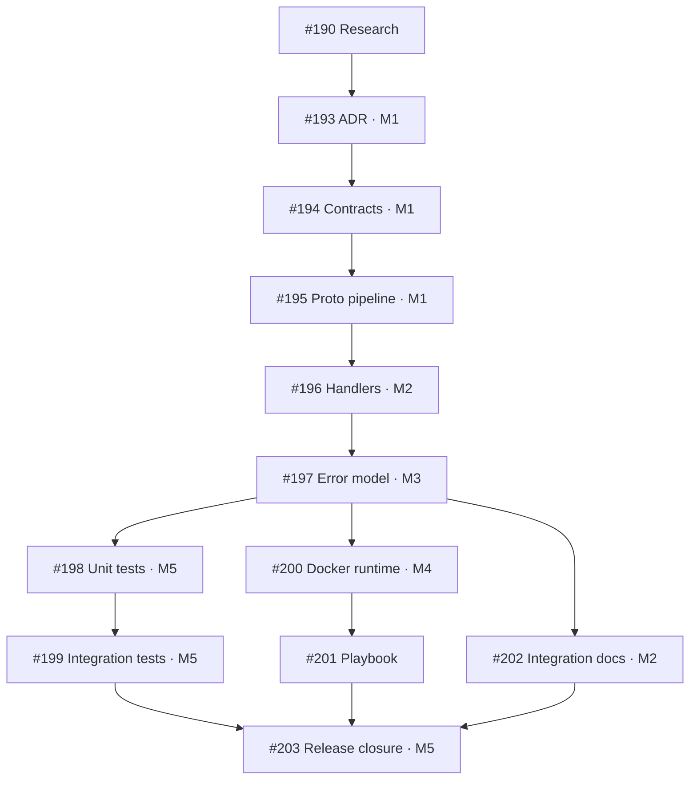

# v0.2.2 Release Implementation DAG

**Release:** Curriculum Graph API Foundation
**Version:** v0.2.2
**Planned Date:** 2026-09-18 (overdue — replanning required; original target 2026-06-15)
**Release Issue:** [#186](https://github.com/AigoraCorporation/aigora/issues/186)
**ADR Anchor:** ADR-TBD-GRPC-FOUNDATION (created via #193)

---

## Overview

This document specifies the implementation order for v0.2.2 as a directed
acyclic graph (DAG) of issues, following the
[Traceability Model](../traceability-model.md).

**Single source of truth.** The edges below are the same ones declared in
each child issue's `Dependencies` section and as GitHub *blocked by*
relationships. All child issues are sub-issues of the release umbrella #186.
When an edge changes, update the issue and this document in the same step.

**Governance model:**

- ADR milestones (M1..M5) form the release structure
- Each feature task references exactly one ADR milestone
- Dependencies between tasks must form a DAG (no cycles)
- PRs close their own task issue (`Closes #<task>`), never the umbrella #186;
  #186 is closed when #203 completes

---

## Dependency Graph

---

## Dependencies Table

| Task | Title | Milestone | Depends On | Blocks | Est. |
|------|-------|-----------|------------|--------|------|
| #190 | Implement read-only gRPC API foundation (research) | — | — | #193 | ~1d |
| #193 | Define ADR for gRPC API Foundation milestones | M1 | #190 | #194 | ~2d |
| #194 | Define and freeze v1 gRPC contracts | M1 | #193 | #195 | ~2d |
| #195 | Add proto generation and contract documentation pipeline | M1 | #194 | #196 | ~3d |
| #196 | Implement gRPC handlers mapped to application use cases | M2 | #195 | #197 | ~3d |
| #197 | Implement standardized gRPC error model and graph_version propagation | M3 | #196 | #198, #200, #202 | ~3d |
| #198 | Add unit tests for mappers and error mapping | M5 | #197 | #199 | ~3d |
| #199 | Add integration tests for successful and failing gRPC flows | M5 | #198 | #203 | ~3d |
| #200 | Add Dockerfile and Docker Compose runtime for gRPC API + Neo4j | M4 | #197 | #201 | ~2d |
| #201 | Document local validation playbook for gRPC API | — (chore) | #200 | #203 | ~1d |
| #202 | Publish API architecture, error model, and integration contract docs | M2 | #197 | #203 | ~2d |
| #203 | Execute v0.2.2 readiness checklist and close release | — (chore) | #199, #201, #202 | — (closes #186) | ~1d |

---

## Execution Phases

### Phase 0 — Research & ADR Baseline (blocking)

#190 → #193

**Gate:** ADR-TBD-GRPC-FOUNDATION exists in
`docs/02-architecture/curriculum-graph/adr/` with milestones M1..M5.

### Phase 1 — Contract Definition (serial)

#194 → #195

**Deliverable:** frozen `.proto` files, generated stubs, contract documentation.

### Phase 2 — Delivery Adapter (serial)

#196 → #197

**Deliverable:** gRPC handlers mapped to use cases, standardized error model,
`graph_version` in all graph responses.

### Phase 3 — Parallel Tracks (after #197)

| Track | Path | Est. |
|-------|------|------|
| A — Quality | #198 → #199 | ~6d |
| B — Runtime | #200 → #201 | ~3d |
| C — Docs | #202 | ~2d |

**Gate:** unit and integration suites pass; coverage ≥ 80%.

### Phase 4 — Release Closure

#203, after #199, #201 and #202. Closes #186.

---

## Critical Path

**#190 → #193 → #194 → #195 → #196 → #197 → #198 → #199 → #203**

Total serial duration: ~21 days. Tracks B and C have ~3d and ~4d of slack
respectively against track A.

---

## Milestone Mapping

| Milestone | Description | Issues |
|-----------|-------------|--------|
| M1 | Define v1 gRPC contract boundary and versioning policy | #193, #194, #195 |
| M2 | Implement delivery adapter | #196, #202 |
| M3 | Standardize error model and response invariants | #197 |
| M4 | Define Dockerized local runtime (API + Neo4j) | #200 |
| M5 | Define validation and release readiness gates | #198, #199, #203 |
| Support | No ADR linkage | #190 (research), #201 (chore) |

---

## Validation Gates

### Before Phase 1

- [ ] #190 complete (research baseline, decision lock approved)
- [ ] ADR-TBD-GRPC-FOUNDATION exists with a milestones table (M1..M5)

### Before Phase 2

- [ ] #194 acceptance criteria met (contracts frozen)
- [ ] #195 acceptance criteria met (generation and docs pipeline working)

### Before Phase 3

- [ ] #196 acceptance criteria met (handlers implemented, unit tests passing)
- [ ] #197 acceptance criteria met (error model and `graph_version` propagation)

### Before Release Closure (#203)

- [ ] #198 met (unit tests, coverage ≥ 80%)
- [ ] #199 met (integration tests passing)
- [ ] #201 met (playbook documented and validated on a clean checkout)
- [ ] #202 met (docs published)

### Release Checklist (#203)

- [ ] ADR-TBD-GRPC-FOUNDATION created with M1..M5
- [ ] All feature tasks reference exactly one milestone
- [ ] Unit and integration tests passing
- [ ] `docker compose up` works from a clean checkout
- [ ] `grpcurl` smoke tests passing for all read operations
- [ ] Documentation published and reviewed
- [ ] Release notes generated
- [ ] v0.2.2 tag created on `main`
- [ ] #186 closed

---

## References

- Release issue: [#186 — Curriculum Graph API Foundation](https://github.com/AigoraCorporation/aigora/issues/186)
- Research baseline: [#190](https://github.com/AigoraCorporation/aigora/issues/190)
- Governance: [Traceability Model](../traceability-model.md)
- ADRs: [`docs/02-architecture/curriculum-graph/adr/`](../../../02-architecture/curriculum-graph/adr/README.md)

---

**Last Updated:** 2026-11-18
**Status:** ACTIVE — Phase 0 (awaiting #190 / #193)
