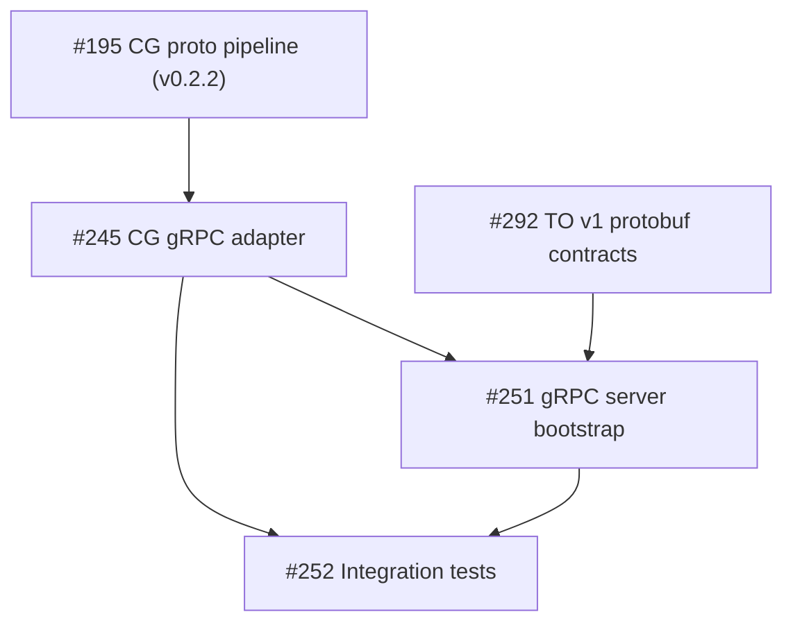

# v0.3.2 Release Implementation DAG

**Release:** Tutor Orchestrator gRPC Runtime
**Version:** v0.3.2
**Component:** Tutor Orchestrator
**Planned Date:** TBD
**Release Issue:** [#291](https://github.com/AigoraCorporation/aigora/issues/291)

---

## Overview

v0.3.2 makes the Tutor Orchestrator executable as a gRPC service. It was split
out of the issues previously labelled "V0.4.0", because the roadmap reserves
v0.4.0 for Student Model Foundation. The Student Model and Assessment gRPC
adapters (#246, #247) stay in v0.4.0; in this release their ports are wired to
placeholder adapters.

**Single source of truth.** The edges below are mirrored in each issue's
`Dependencies` section and as GitHub *blocked by* relationships. All tasks are
sub-issues of #291. PRs close their own task issue, never the umbrella.

---

## Dependency Graph

Closed v0.3.0 prerequisites (already satisfied) are listed in the table only.

---

## Dependencies Table

| Issue | Title | Depends On | Blocks |
|-------|-------|------------|--------|
| #292 | Define v1 protobuf contracts for the Tutor Orchestrator API | — | #251 |
| #245 | Implement Curriculum Graph gRPC application adapter | #195 (v0.2.2); #235, #237, #248 (v0.3.0, closed) | #251, #252 |
| #251 | Bootstrap gRPC server | #292, #245; #244, #250 (v0.3.0, closed) | #252 |
| #252 | Implement integration tests | #245, #251; #241–#244, #250 (v0.3.0, closed) | — (release closure) |

---

## Critical Path

**v0.2.2 (#195) → #245 → #251 → #252**

#292 runs in parallel with #245. The release cannot start #245 until the
Curriculum Graph v1 stubs exist (#195 in v0.2.2), so v0.2.2 progress gates this
release.

---

## Moved to v0.4.0 — Student Model Foundation

| Issue | Title | Reason |
|-------|-------|--------|
| #246 | Implement Student Model gRPC adapter | Requires the Student Model service contract (v0.4.0) |
| #247 | Implement Assessment gRPC adapter | Requires the Assessment service contract |

---

**Last Updated:** 2026-11-18
